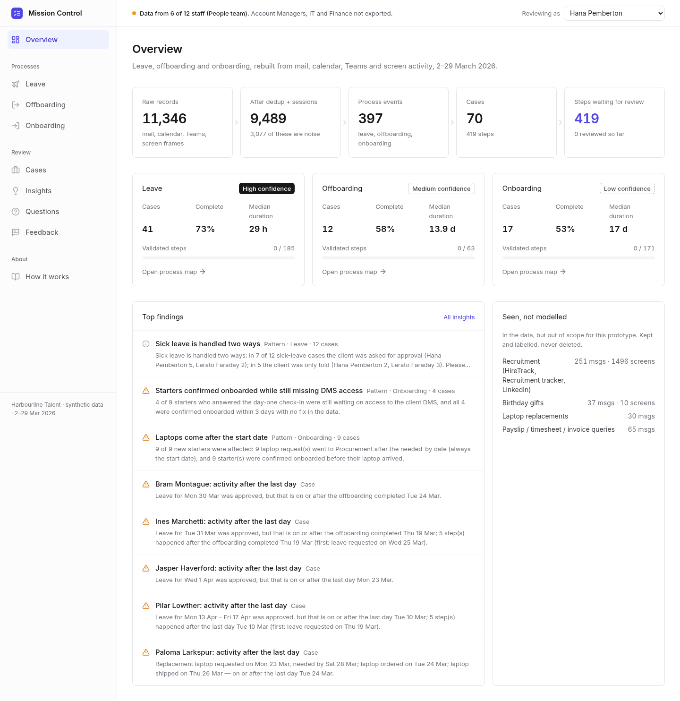
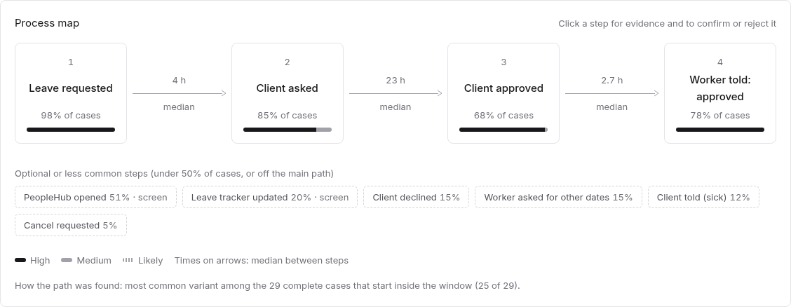
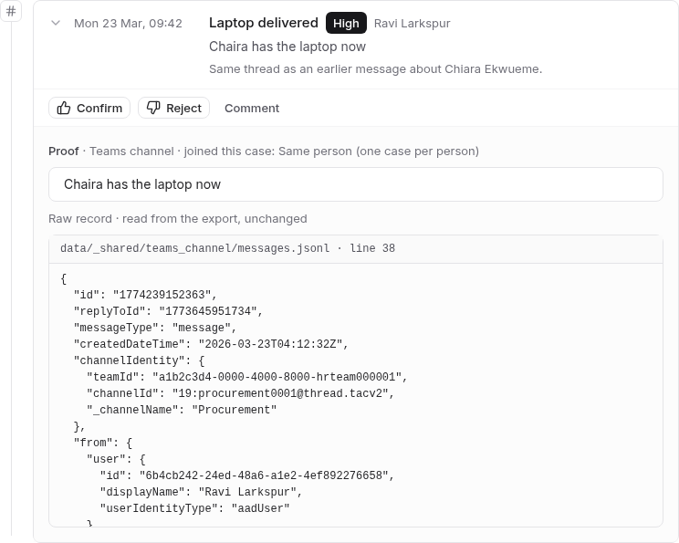

# Mission Control

Mission Control rebuilds how the People team really works from their digital traces, and lets staff confirm or correct it.

It covers **leave, offboarding and onboarding** at Harbourline Talent, using mail, calendar, Teams and screen activity from 2–29 March 2026 (synthetic data). Everything runs on one machine.



<p>
  
  
</p>

## Quick start

**To see original records in the Proof panel, copy the data/ folder from the challenge zip into the repo root.**

Needs Python 3.10+ and Node 20+, or only Docker. Then open http://localhost:8000.

| option | command | notes |
|---|---|---|
| Local | `make install start` | Builds the UI; FastAPI serves UI + API on :8000 |
| Docker | `docker compose up` | Same app in a container; feedback kept in a volume |
| Develop | `make dev` | After `make install`: API on :8000 with reload, Vite on :5173 (open that one) |

`out/` is committed, so the app works without the raw export; only the **Proof** panel (original records) is disabled.
To enable it and rebuild `out/`, put the export in `data/` (`data/_shared/…`, `data/<person>/…`, git-ignored) and run `make pipeline`.
API docs: http://localhost:8000/docs.

## What it found

1. **Laptops always come after the start date: 9 of 9 new starters.** Every request went to Procurement 2–4 days after the needed-by date (always the start date), and all 9 starters were confirmed onboarded before their laptop arrived.
2. **Starters are confirmed onboarded while client DMS access is still missing: 4 of 9** who answered the day-one check-in, at 4 different clients, all confirmed within 3 days with no fix in the data.
3. **Activity after the last day: 5 people.** Leave was approved after leaving for Bram Montague, Ines Marchetti, Jasper Haverford and Pilar Lowther; a replacement laptop was ordered and shipped for Paloma Larkspur on or after her last day.
4. **Sick leave is handled two ways.** In 7 of 12 sick-leave cases the client was asked for approval; in 5 the client was only told. Both staff members do both.
5. **The Leave tracker is probably updated in batches.** It was open within 30 minutes of a PeopleHub or approval step in only 8 of 41 leave cases. This is one of 14 open questions for staff.

## How it works

Raw export → 6 pipeline steps (after a profiling step 0), each writing a file to `out/` → FastAPI → React → staff feedback.
Diagram and details: [docs/architecture.md](docs/architecture.md). File and API shapes: [docs/schemas.md](docs/schemas.md).

| step | what it does | output | count |
|---|---|---|---|
| 1 Ingest | Reads 5 sources into one event shape, converts times, removes duplicates across mailboxes, groups screen frames into sessions | [`1_events.jsonl`](out/1_events.jsonl) | 11,346 raw records → 9,489 events |
| 2 Clean | Text rules label each event and pick its activity; names are resolved to people with a reason | [`2_events_clean.jsonl`](out/2_events_clean.jsonl) | 397 process · 4,067 context · 3,077 noise · 1,948 out of scope |
| 3 Cases | Joins steps into cases by thread, dates, person and time; sets status and window badges | [`3_cases.json`](out/3_cases.json) | 70 cases, 419 steps |
| 4 Discover | Step frequency, directly-follows graph, variants, main path, median times, open questions | [`4_processes.json`](out/4_processes.json) | 3 processes, 14 open questions |
| 5 Flags | Rule checks with evidence events | [`5_flags.json`](out/5_flags.json) | 30 flags |
| 6 Insights | Groups flags into patterns (systemic) and case flags (one-off) | [`6_insights.json`](out/6_insights.json) | 3 patterns, 7 case flags |

The pipeline is deterministic (same input, same output) and never writes to `data/`.

## How staff validate

Every screen asks the people who do the work:

* **Confirm / reject** any case step, process step or insight, with an optional comment.
* **Add a step** the data does not show, to a case or to a process.
* **Answer open questions**, for example "Do you update the Leave tracker after each request, or in batches?"
* **"Is this the same person?"** for two records that may be one person (a personal and a work address).

Feedback is saved to SQLite (`backend/feedback.db`) and appended to `out/feedback.jsonl`, and can be exported from the Feedback page.

## Design decisions and trade-offs

* **Rules, not an LLM, on this data.** The messages are templated, so rules are deterministic, private (nothing leaves the machine) and provable.
* **Every step links to its raw record.** "Proof" shows the original export line, unchanged, with file and line number.
* **A screen shows what was open, not what was done.** Screen-based steps are always "Likely".
* **Status and window are separate.** Status is the outcome (complete, in progress, declined, cancelled); badges say when a case started before or continues after the export.
* **Name matching writes its reason.** Email, full name, first name + initial, then case context; when more than one person fits, it says "ambiguous" instead of guessing.
* **"Data from 6 of 12 staff" is always visible.** Account Managers, IT and Finance were not exported.
* **Screen frames are merged into sessions.** 9,927 frames become 8,250 sessions (same window, short gaps), so one task is one event.

## Where AI fits

**Not used on this dataset, and why:** the messages are templated, so rules already label them exactly, with no cost, no data leaving the machine, and a reason for every decision.

On real data, each record would go down a ladder and stop at the first step that is sure:

1. **Rules**: exact text patterns, as today.
2. **Similarity**: match against records staff already confirmed.
3. **LLM**: strict JSON output (activity, person, confidence), never free text.
4. **Human review**: low-confidence results go to the confirm / reject screens.
5. **New rule**: confirmed patterns become rules, so the LLM is needed less over time.

Other places an LLM helps: mapping a new source's fields to the event shape, naming steps of an unknown process, writing case summaries, and an assistant that answers questions ("Which starters had no laptop on day one?") with the event ids as proof.

Guardrails: AI stays optional (the pipeline runs without it), every answer cites event ids, every output logs the model and prompt version, and personal data is redacted before any call.

## Production path

* **One adapter per source** (Microsoft Graph mail, calendar and Teams, screen logs), each writing the same event shape.
* **Quarantine bad records** (unparseable time, unknown format) instead of dropping or guessing.
* **HR system as the identity source**, so names resolve against real employee and worker records.
* **Process mining for unknown processes**: cluster unlabelled events, then ask staff to name them.
* **Monitor the unmatched share**: alert when more records fall through the rules than usual.
* **An evaluation set**: staff-confirmed cases, used to score every rule or model change before it ships.

## Limits

* Synthetic, templated data; the rules would need work for real free text.
* Data from 6 of 12 staff, so some triggers and confirmations are invisible.
* Four weeks (2–29 March); cases outside the window are badged, not completed.
* A screen log shows what was open, not what was done.
* Onboarding's main path has **low** confidence: only 3 complete in-window cases (offboarding 4: medium; leave 29: high).
* No login: "Reviewing as" is a picker. Feedback does not change the model yet.

## What I'd do next

* **LLM fallback for messy text**, measured against a staff-confirmed accuracy test before it is switched on.
* **HR system as the identity source**, so people resolve against real employee and worker records.
* **Feedback that updates the rules automatically**: confirmed and rejected steps feed back into labelling and case linking.
* **Ingest the other 6 staff** (Account Managers, IT, Finance) to close the missing triggers and confirmations.

## Repo map

```
pipeline/       pipeline.py (steps 0–6), rules.py (rule table), tests/
out/            committed pipeline outputs (+ feedback.jsonl at runtime, git-ignored)
backend/app/    FastAPI: main.py, config.py, store.py, db.py, routers/, services/, schemas/
backend/tests/  endpoint tests, feedback round trip, API snapshots
frontend/       React + Vite + TypeScript + Tailwind; scripts/screenshots.mjs
docs/           architecture.md, schemas.md, demo-script.md, screenshots/
Makefile  Dockerfile  docker-compose.yml
```

| file | contents |
|---|---|
| [`0_profile.json`](out/0_profile.json) | Records per person and source, time formats, duplicates, coverage (6 of 12 staff) |
| [`1_events.jsonl`](out/1_events.jsonl) | Non-screen events in one shape, with a `raw_ref` to the export |
| [`2_events_clean.jsonl`](out/2_events_clean.jsonl) | Labelled events: category, activity, resolved people, extracted fields |
| [`2_people.json`](out/2_people.json) | People and organisations, merges and "possible same person" pairs |
| [`2_screen_summary.json`](out/2_screen_summary.json) | Context, noise and out-of-scope screen sessions, summarised by window title |
| [`3_cases.json`](out/3_cases.json) | Cases with steps, confidence, status, window badges |
| [`4_processes.json`](out/4_processes.json) | Main path, steps, variants, directly-follows graph, open questions |
| [`5_flags.json`](out/5_flags.json) | Rule hits with evidence event ids |
| [`6_insights.json`](out/6_insights.json) | Patterns and case flags |
| [`pipeline_report.json`](out/pipeline_report.json) | Counts per stage and per activity |

API: every endpoint and response shape is at `/docs` (OpenAPI) when the app runs.

Walkthrough for the interview: [docs/demo-script.md](docs/demo-script.md).

## Data

The data is synthetic. The raw export is not in this repo. Screenshots show synthetic records.
`out/` keeps message text cut to 200 characters. Tests that need raw records use a small invented fixture (`backend/tests/fixtures/data/`).
