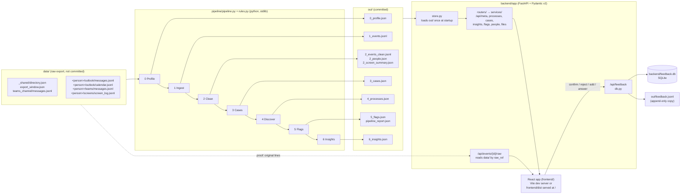

# Architecture

Everything runs on one machine. The pipeline turns the raw export into committed JSON files in `out/`, the API serves those files read-only, the React app shows them, and staff feedback is the only thing written back.

## The pipeline, step by step

**0. Profile → `0_profile.json`.** Counts records per person and source, the time range, the time-format variants (UTC `Z`, `+05:30` offsets, naive calendar times with a Windows time-zone name) and duplicates across mailboxes. It also records coverage: 6 of 12 staff were exported.

**1. Ingest → `1_events.jsonl`.** Reads the five sources into one event shape, converts every time to Asia/Colombo and UTC, and deduplicates the same item seen in several mailboxes (mail by `internetMessageId`, Teams by `chatId + id`, calendar by `iCalUId`), keeping `seen_in`. Screen frames of the same window (same mailbox and title, gaps of 10 minutes or less) become one session. Each event keeps a `raw_ref` (file and line) back to the export. Screen sessions are not written here because of their volume.

**2. Clean → `2_events_clean.jsonl`, `2_people.json`, `2_screen_summary.json`.** A rule table (`pipeline/rules.py`) labels every event as process, context, noise or out of scope, assigns an activity such as "Client asked", and extracts dates, client and needed-by fields. Screens are read by window title and address, never by the app name. A person registry is built from addresses and display names; personal and work addresses are merged only with onboarding evidence. Names in text are resolved in order: email, full name, first name plus initial, then first name or typo using case context. Each resolution stores a plain-English reason, or `ambiguous` when more than one person fits. Context, noise and out-of-scope screen sessions go to the summary file.

**3. Cases → `3_cases.json`.** Leave cases are keyed by person and dates. Offboarding and onboarding have one case per person. Threads join first, then dates, then time. Screen sessions and SwiftParcel mails have no name, so they join only by time and are marked "Likely". Each case gets an outcome status (complete, in progress, declined or cancelled), window badges (started before 2 Mar, continues after 29 Mar) and each person's last day for cross-process checks.

**4. Discover → `4_processes.json`.** For each process: how often each step occurs, a directly-follows graph, variants, the main path (the most common complete variant, or a consensus order when none repeats), median hours between steps, optional steps, and open questions for staff. No order is hard-coded.

**5. Flags → `5_flags.json`, `pipeline_report.json`.** Rule checks with evidence events: activity after a person's last day, onboarded before the laptop, laptop requested late, onboarded with an open day-one issue, cancel with no follow-up, sick leave handled two ways. The flag ids are written back onto the cases.

**6. Insights → `6_insights.json`.** Groups flags into process insights (a rule that hits at least 3 cases and at least half of the eligible ones, or the same issue at 3 or more clients) and case flags. The two laptop flags are merged per starter. Each process gets a path confidence of high, medium or low, depending on how many complete in-window cases its path rests on.

The pipeline is deterministic: the same input gives byte-identical output. It never writes to `data/`.

## Serving

* **API** (`backend/app/`): `store.py` loads `out/` once at startup; routers are a thin HTTP layer over `services/`; every response is a Pydantic model (see [schemas.md](schemas.md) and `/docs`). `/api/files/{name}` serves the `out/` files from an allow-list. `/api/events/{id}/raw` returns the original export line(s) by `raw_ref`, or a 503 "Raw data not available on this server" when `data/` is not deployed.
* **Frontend** (`frontend/`): React, Vite, TypeScript, Tailwind and shadcn-style components. It reads only `/api`. In dev, Vite proxies `/api` to FastAPI. In production, FastAPI serves `frontend/dist` at `/` with a fallback to `index.html` for client-side routes.
* **Feedback**: `POST /api/feedback` validates the target (case step, process step, case, open question, insight, identity) and writes to SQLite and to `out/feedback.jsonl`. `GET /api/feedback/export` downloads it as JSONL.
