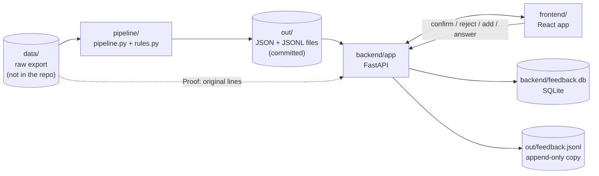
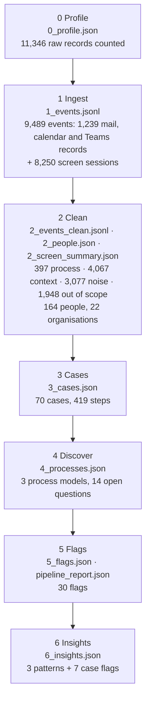
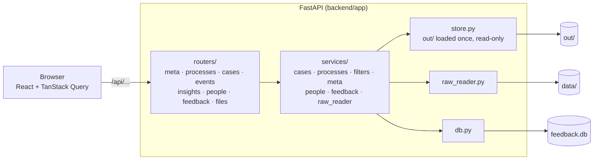
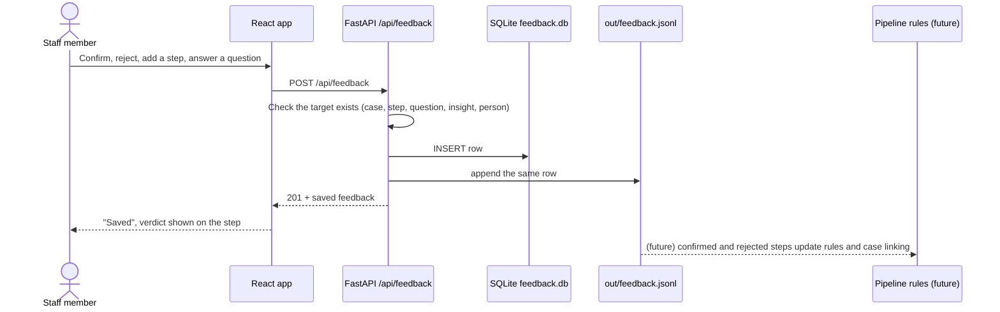
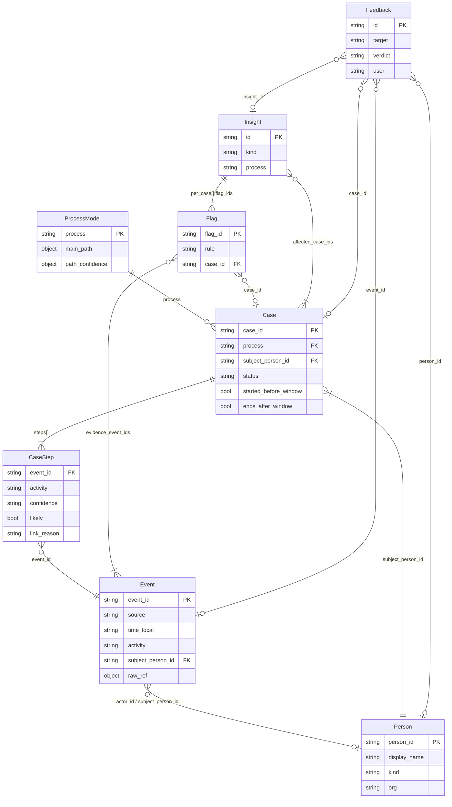
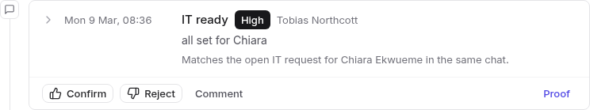

# Architecture

Mission Control is one repository that runs on one machine. A Python pipeline turns the raw export into JSON files in `out/`. A FastAPI service serves those files read-only, a React app shows them, and staff feedback is the only thing written back.

Contents: [system overview](#1-system-overview) · [pipeline](#2-pipeline) · [runtime](#3-runtime) · [feedback loop](#4-feedback-loop) · [data model](#5-data-model) · [follow one record](#follow-one-record) · [design decisions](#key-design-decisions) · [tech stack](#tech-stack)

## 1. System overview



The pipeline runs once, offline, and is deterministic: the same export gives the same `out/` files.
The API loads `out/` at startup and never changes it. It reads `data/` only to show a record's original line(s) in the Proof panel.
The React app talks only to `/api`. Feedback goes to SQLite and to an append-only JSONL file, so it can be read without the app.

## 2. Pipeline



Each step reads the previous step's output and writes its own file, so every stage can be opened and checked on its own.
Step 1 removes duplicates across mailboxes and groups 9,927 screen frames into 8,250 sessions. Only the 1,239 mail, calendar and Teams records are written to `1_events.jsonl`; the sessions are labelled in step 2.
Step 2 keeps every event. `2_events_clean.jsonl` (1,660 rows) holds all 1,239 records plus 421 screen sessions (23 process, 398 context); the other 7,829 sessions (context, noise, out of scope) are summarised by window title in `2_screen_summary.json`.
Nothing is deleted; noise and out-of-scope work keep a reason.

## 3. Runtime



Routers only validate input and call a service; services hold the logic; every response is a Pydantic model (see [schemas.md](schemas.md) or `/docs`).
`store.py` reads `out/` once at startup into lookup tables; it is the only shared state and is never written to.
`raw_reader.py` finds a record's original line(s) by its `raw_ref` (file + line). Without `data/` it returns "Raw data not available on this server" and the rest of the app works.
In development Vite proxies `/api`; in production FastAPI also serves the built UI at `/`.

## 4. Feedback loop



Every feedback row names what it is about (`case_id`, `event_id`, `question_id`, `insight_id` or `person_id`), who gave it and when.
The API refuses feedback that points at something that does not exist (422).
Today feedback is stored and shown; it does not change the model yet. The last arrow is the next step: re-run the pipeline with a "validated" layer built from these rows.

## 5. Data model



Everything links by readable ids (see [ID conventions](schemas.md#id-conventions)): a case id names its process and person, an event id names its source.
A case step is an event placed in a case, with the confidence and the reason it joined. A flag is one rule hit on one case; an insight groups flags into a pattern or keeps one as a case flag.
Open questions live inside each process model (`open_questions[].id`, for example `leave-q1`) and feedback can answer them by `question_id`.

## Follow one record

Tobias Northcott (IT Support) writes "all set for Chiara" to Hana in a Teams chat on Mon 9 Mar. This is how that one message moves through the system.

**1. Raw line** (`data/hana/teams/messages.jsonl`, line 23). The export is not in this repo, so the real line is not reproduced here; `GET /api/events/{id}/raw` shows it when `data/` is present. This invented record from the test fixture has the same shape:

```json
{
  "id": "1000000000001",
  "chatId": "19:fake-sam_fake-it@unq.gbl.spaces",
  "chatType": "oneOnOne",
  "createdDateTime": "2026-03-12T05:00:00Z",
  "from": { "user": { "id": "fake-it", "displayName": "Ivy Example" } },
  "body": { "contentType": "html", "content": "<p>all set for Test</p>" },
  "_members": ["Sam Sample", "Ivy Example"]
}
```

**2. Event** (step 1, `out/1_events.jsonl`). One shape for every source; the time is converted to Sri Lanka time and UTC, the sender becomes a person id, and `raw_ref` points back to the line.

```json
{
  "event_id": "teams_chat:19:f28c105d-…@unq.gbl.spaces:1773025571882",
  "source": "teams_chat",
  "mailbox": "hana",
  "time_local": "2026-03-09T08:36:11+05:30",
  "time_utc": "2026-03-09T03:06:11Z",
  "actor_id": "p_tobias-northcott",
  "recipients": ["p_hana-pemberton"],
  "text": "all set for Chiara",
  "thread_key": "chat:19:f28c105d-…@unq.gbl.spaces",
  "raw_ref": { "file": "data/hana/teams/messages.jsonl", "line": 23 }
}
```

**3. Cleaned event** (step 2, `out/2_events_clean.jsonl`). A text rule (`on_it_ready_named`) labels it as the onboarding activity `it_ready`. "Chiara" is resolved to a person, with the method and a plain reason.

```json
{
  "category": "process",
  "process": "onboarding",
  "activity": "it_ready",
  "subject_person_id": "p_chiara-ekwueme",
  "resolution": {
    "method": "thread",
    "confidence": "high",
    "raw_name": "Chiara",
    "candidates": ["p_chiara-ekwueme"],
    "reason": "Matches the open IT request for Chiara Ekwueme in the same chat"
  },
  "fields": { "rule_id": "on_it_ready_named", "name_raw": "Chiara", "owner_staff_id": "p_hana-pemberton" }
}
```

**4. Case step** (step 3, `out/3_cases.json`). The event becomes step 3 of 13 in Chiara's onboarding case. The case is complete and carries a "started before 2 Mar" badge because its trigger is not in the data.

```json
{
  "case_id": "onboarding:chiara-ekwueme",
  "status": "complete",
  "started_before_window": true,
  "ends_after_window": false,
  "step": {
    "activity": "it_ready",
    "label": "IT ready",
    "actor_name": "Tobias Northcott",
    "time_local": "2026-03-09T08:36:11+05:30",
    "confidence": "high",
    "likely": false,
    "link": "person",
    "link_reason": "Same person (one case per person)"
  }
}
```

**5. Process map support** (step 4, `out/4_processes.json`). Across all 17 onboarding cases, "IT ready" appears in 12, so it is on the main path with 70.6% support. The onboarding path as a whole has low confidence: it rests on 3 complete in-window cases.

```json
{
  "activity": "it_ready",
  "label": "IT ready",
  "support_pct": 70.6,
  "case_count": 12,
  "confidence_mix": { "high": 6, "medium": 6 },
  "on_main_path": true,
  "median_to_next_h": 49.7,
  "next_on_main_path": "kickoff_meeting"
}
```

**6. Insight** (steps 5–6, `out/5_flags.json`, `out/6_insights.json`). This message is not evidence for a flag itself, but its case is: Chiara's laptop was requested 4 days after her start date and arrived after she was confirmed onboarded. Those two flags join 8 other starters' in the pattern "Laptops come after the start date".

```json
{
  "id": "ins:onboarding:laptop_late",
  "kind": "process_insight",
  "title": "Laptops come after the start date",
  "rules": ["onboarded_before_laptop", "laptop_requested_late"],
  "per_case": [{
    "case_id": "onboarding:chiara-ekwueme",
    "flag_ids": ["laptop_requested_late:onboarding:chiara-ekwueme", "onboarded_before_laptop:onboarding:chiara-ekwueme"],
    "message": "Chiara Ekwueme: laptop needed by Thu 12 Mar (the start date), so 4 day(s) late; the laptop arrived 7.0 days later (Mon 23 Mar)."
  }]
}
```

**7. Screen.** `GET /api/cases/onboarding:chiara-ekwueme` adds names, the message text and the resolution to the step, and the case page shows it with its confidence badge, Confirm / Reject and Proof:



**8. Feedback row.** Lerato confirms the step. `POST /api/feedback` stores this row in SQLite and appends it to `out/feedback.jsonl`:

```json
{
  "id": "6cadb282fb65",
  "created_at": "2026-11-19T08:27:22.746761Z",
  "user": "Lerato Faraday",
  "target": "case_step",
  "verdict": "confirm",
  "process": "onboarding",
  "case_id": "onboarding:chiara-ekwueme",
  "event_id": "teams_chat:19:f28c105d-…@unq.gbl.spaces:1773025571882",
  "activity": "it_ready",
  "note": "Yes, Tobias confirmed IT was ready."
}
```

Long ids are shortened with "…" above; the full id is `teams_chat:19:f28c105d-3926-4a17-aa09-f29d953f48f1_6bf46c69-0a09-4f64-aab1-c3ba13deef86@unq.gbl.spaces:1773025571882`. The feedback row was produced against a temporary database; the repo ships with no feedback.

## Key design decisions

The reasons are in the [README](../README.md#design-decisions-and-trade-offs).

* Rules, not an LLM, on this templated data: deterministic, private, provable.
* Every step keeps a `raw_ref` to its original line (Proof).
* Screen-based steps are always "Likely": a screen shows what was open, not what was done.
* Status (outcome) and window badges (data before 2 Mar / after 29 Mar) are separate.
* Name matching stores its method and a reason; when more than one person fits, it says "ambiguous".
* Coverage ("Data from 6 of 12 staff") is shown on every page.
* Screen frames are merged into sessions, so one task is one event.

## Tech stack

| layer | technology | why |
|---|---|---|
| Pipeline | Python 3.10+, standard library only | Runs anywhere, no install needed for the data step |
| Rules | One table in `pipeline/rules.py` | All labelling in one readable place |
| API | FastAPI, Pydantic v2, Uvicorn | Typed responses, OpenAPI docs at `/docs` |
| Storage | JSON/JSONL files in `out/`; SQLite for feedback | Outputs are plain files anyone can open; feedback needs writes |
| UI | React 18, TypeScript, Vite 5, Tailwind 3, TanStack Query, Radix | Fast to build, typed against the API |
| Tests | pytest (pipeline rules, every endpoint, API snapshots), ruff | Behaviour is pinned before refactors |
| Packaging | Make, Docker (one image), Docker Compose | One command to run |
| Screenshots | Playwright (`frontend/scripts/screenshots.mjs`) | Re-takes every screen and checks the demo path |
